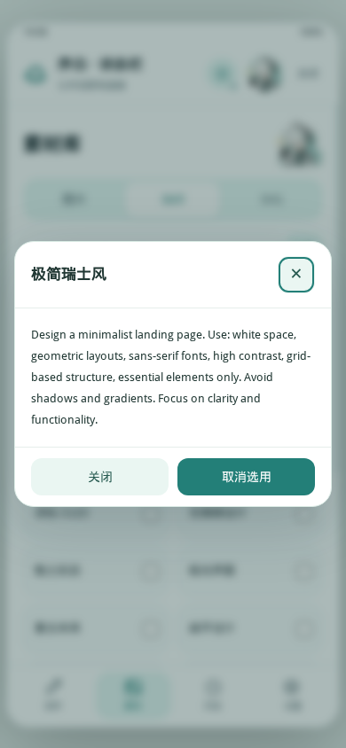

# 序白 · 状态栏生成器

SillyTavern 状态栏生成工具，依赖酒馆助手。

## 安装

在酒馆扩展管理中通过仓库地址安装本扩展，并安装、启用酒馆助手。首次使用前请备份旧版数据。旧版酒馆助手脚本与插件不要同时启用。

## 开发

源码按功能存放在 `src/`，按文件名顺序组合为 `index.js`。运行 `node tools/build.mjs` 后提交生成的文件。`.part.js` 是同一作用域的片段，不可单独运行。

用户配置、密钥、历史、图库和世界书不包含在仓库中。插件转换后尚需在真实酒馆环境中验证接口与数据兼容性。

## v3.8.1 素材库调整

素材页直接切换图片、Skill 和 SVG；不再使用三级入口或重复分类。创作页的「选择 Skill / 风格」会显示已选数量。点击素材名称查看正文，勾选复选框多选；详情页也可选用。浏览和选择不会调用模型。

内置条目是风格、配色、字体的设计参考文本；完整自定义 Skill 可在设置中导入。它们不附带虚构的效果图。

详情窗口隔离宿主样式，标题、关闭键、选用按钮固定可见，正文单独滚动。已在 Chromium 的 320 × 568、390 × 844 视口检查长正文、勾选、搜索和页面切换；仍需在实际酒馆中验证宿主兼容性。

以下为实际界面截图（浏览器模拟手机尺寸）：

