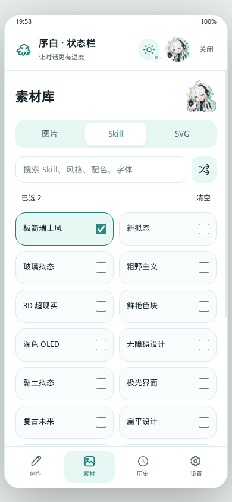
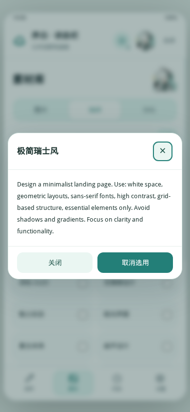

# 序白 · 状态栏生成器

SillyTavern 状态栏生成工具，依赖酒馆助手。

## 安装

在酒馆扩展管理中通过仓库地址安装本扩展，并安装、启用酒馆助手。首次使用前请备份旧版数据。旧版酒馆助手脚本与插件不要同时启用。

## 开发

源码按功能存放在 `src/`，按文件名顺序组合为 `index.js`。运行 `node tools/build.mjs` 后提交生成的文件。`.part.js` 是同一作用域的片段，不可单独运行。

用户配置、密钥、历史、图库和世界书不包含在仓库中。插件转换后尚需在真实酒馆环境中验证接口与数据兼容性。

## v3.8.1 素材库调整

素材页直接切换图片、Skill 和 SVG；不再使用三级入口或重复分类。创作页的「选择 Skill / 风格」会显示已选数量。点击素材名称查看正文，勾选复选框多选；详情页也可选用。浏览和选择不会调用模型。

内置条目是风格、配色、字体的设计参考文本；完整自定义 Skill 可在设置中导入。它们不附带虚构的效果图。

详情窗口隔离宿主样式，标题、关闭键、选用按钮固定可见，正文单独滚动。已在 Chromium 的 320 × 568、390 × 844 视口检查长正文、勾选、搜索和页面切换；仍需在实际酒馆中验证宿主兼容性。

以下为实际界面截图（浏览器模拟手机尺寸）：




## v3.8.2 状态栏发送范围与参考正则

选择已有正则后，可锁定其匹配格式重新设计显示样式；保存新正则时保留原运行设置，不覆盖原正则。检查原替换内容中的数字和命名捕获组引用，缺少时阻止保存。

创作页可设置发送最近几楼状态栏，选择在保存时附带过滤规则；也可在已有正则列表中单独生成过滤规则。设为 0 不发送历史状态栏，设为 1 发送上一条 AI 回复中的状态栏。过滤仅影响发送给模型的提示词，不修改聊天文件或显示。

过滤深度以一条用户消息、一条 AI 回复交替排列为前提。其他消息顺序、继续生成和扩展注入的内容可能影响结果。当前仅支持以明确、成对的字面标签开头的正则，无法识别时会拒绝生成，需检查真实提示词以验证。


## v3.8.3 使用 AI 修改已有正则

在创作页列出已有正则，选中后点击「载入后让 AI 修改」，填写意见并生成。结果可保存为新正则，或者确认后更新原正则；更新时会检查原内容是否已经变化。

仅发送提示词的规则及普通文本正则使用文本编辑流程，空替换内容不会包成 HTML；可选用楼层设置调整提示词过滤规则的深度。状态栏外观正则默认保留原匹配格式和捕获组，显示预览后可继续修改。发送给 AI 的参考内容可能包含原正则的文本及代码。


## 3.8.4：绑定世界书

需同时安装并启用 [世界书管理器 2.7.0](https://github.com/cchh3297433176-hub/kelaode)。

在“保存到”选择“世界书”，即可搜索绑定目标。默认勾选“仅全局已开启”，当前角色主要世界书不出现在该列表；取消全局筛选后可以选择尚未启用的其他世界书。

生成后点击“绑定世界书”，保存显示正则以及勾选的配套发送过滤正则。数据随世界书文件携带，后续由管理器按世界书启停管理。绑定不会自动开启目标世界书，也不额外写入普通全局正则。选择目标不会自动读取世界书正文作为 AI 上下文；格式说明仍使用现有的“写入世界书”操作。

筛选测试：`node --test tests/worldbook-binding.test.cjs`。


## 3.8.5：可选交互功能

创作页的“交互功能”提供三个独立复选项，默认全部关闭，可组合使用：

- **开场白跳转**：动态读取当前角色卡的开场白及标题/简介注释；没有注释时使用正文预览。新增、修改、排序后刷新显示，不维护固定菜单。单角色聊天中点击后切换第0楼的开场白页；若卡片更新的版本尚不存在于聊天页，追加该版本并切换，保留旧页和后续消息。菜单页用 `【开场白菜单】` 标记排除。
- **填写后直接发送**：表单校验后，使用酒馆助手结构化接口直接创建用户消息并请求回复，不经过输入框。防止重复提交；消息已创建但回复请求失败时，提示手动继续，不重复发送。
- **选择后填入输入框**：确认选择后填入酒馆输入框，默认追加保留草稿，不发送。

生成、换版、修改请求仅附带当前勾选功能的说明及完整参考函数，生成历史保存勾选项，恢复历史时还原。代码模板需由模型完整复制适配到成品，并非工作台自动注入成品的运行库。勾选不会直接发送当前聊天消息。纯文本过滤规则不支持这些交互；添加交互前需解除“保留原有结构/功能”锁定。

运行依赖：酒馆助手及其同层前端渲染。独立沙盒预览没有酒馆接口，不能用于验证实际开场白切换或发送。模板每2秒在可见文档中重新读取，卸载时清理；读取的是酒馆内存中当前角色卡，外部修改仍需先让酒馆加载新版本。功能模板不包含模型自动摘要，标题/简介可用下方格式随开场白保存：

```html
<!-- title: 雨夜重逢 -->
<!-- desc: 两人在便利店门口再次相遇。 -->
<!-- tag: 重逢 -->
开场白正文……
```

[完整提示词与参考代码](docs/interaction-reference.md)。测试：`node --test tests/*.test.cjs`，构建：`node tools/build.mjs`。上述测试使用模拟接口，实际生成质量及酒馆宿主兼容性仍需实机验证。

## 3.8.6：美化保存与可选发送过滤分离

修复“附带发送过滤”不支持当前匹配格式时，美化本体也无法保存的问题。不支持自动过滤的规则仍可另存、更新原正则或绑定世界书，并明确提示过滤未附带、“发送最近几楼”未生效。不会猜测过滤边界。非法楼层数、实际存储错误等仍正常报错，不显示成功。

## 3.8.7：〔…〕格式发送过滤

支持为使用明确 `〔…〕` 外边界的状态栏生成发送过滤，直接复用原美化匹配条件，仅补充全局匹配标志，不放宽字段或跨行范围。继续沿用现有“发送最近几楼”设置。其他无法识别的格式仍按3.8.6行为保存美化并提示过滤未附带。

## 3.8.8：生成时联动配套发送过滤

创作前勾选“生成时配套发送过滤（隐藏旧楼状态栏）”，生成请求会要求模型同时提供状态栏原文样例和普通正文样例。插件复用美化的同一条匹配条件作为过滤条件，并检查状态栏匹配、普通正文不匹配以及相邻正文保留；不再在保存新生成结果时猜测标签或括号格式。新建、修改、换版均按当前勾选项执行。

配套资料、勾选项和当时的楼层设置随历史结果保存，载入时恢复。保存时再次核对配套资料是否仍对应当前美化。样例缺失或校验失败会保留美化并显示过滤未就绪，不能静默使用旧识别规则替代。未勾选则不要求模型生成额外校验样例；生成完成后才勾选时，需要重新生成才能获得配套校验。旧历史及“为已有正则生成过滤”继续沿用旧格式识别。

样例校验只验证有限输入，不保证任何未来输出；实际发送深度仍受酒馆消息排列与其他扩展影响。未使用真实模型或真实酒馆会话验证本次联动。

## 3.8.9 按时间切换外观

创作页可开启「按时间切换外观」，为生成的状态栏添加多个北京时间时段。每段可设置开始、结束和外观描述。结束早于开始表示跨午夜，结束时刻归下一段，空档沿用基础外观。时段重叠或填写不完整时，会在发起生成前提示。

功能默认关闭。开启后，新建、修改和换版会把时段表及浏览器端的参考代码交给模型，配置随历史方案保存。成品用浏览器时钟自动切换，沿用原有剧情时间和输出格式。
